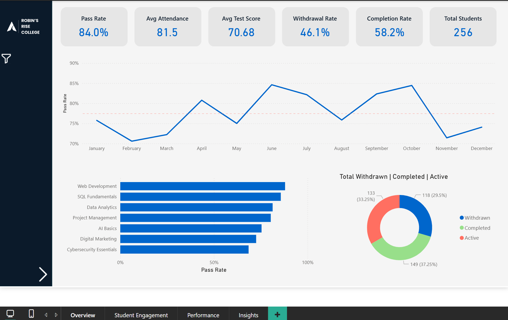
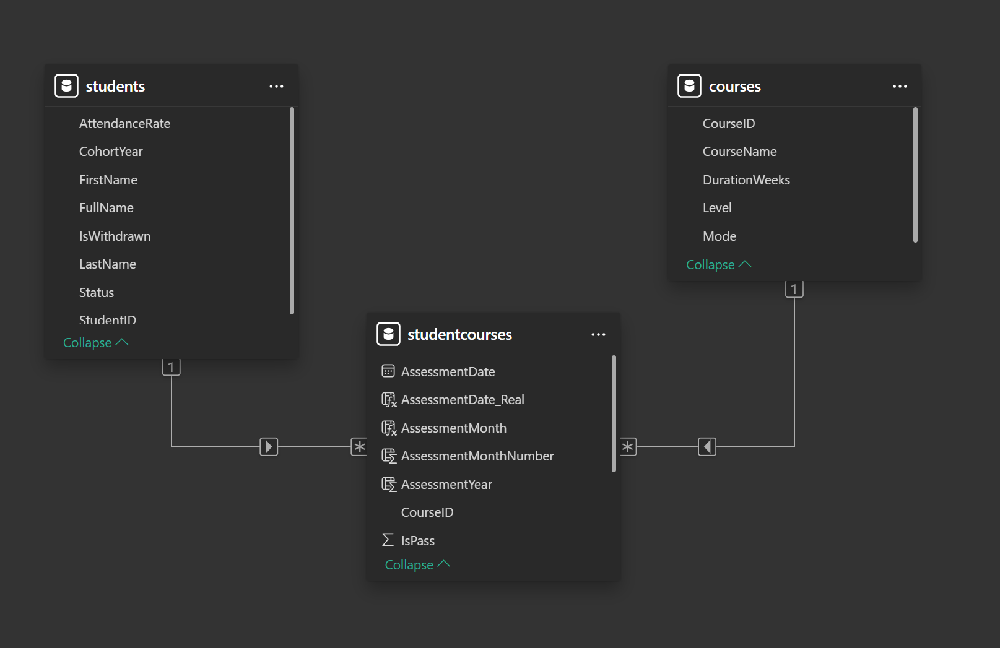
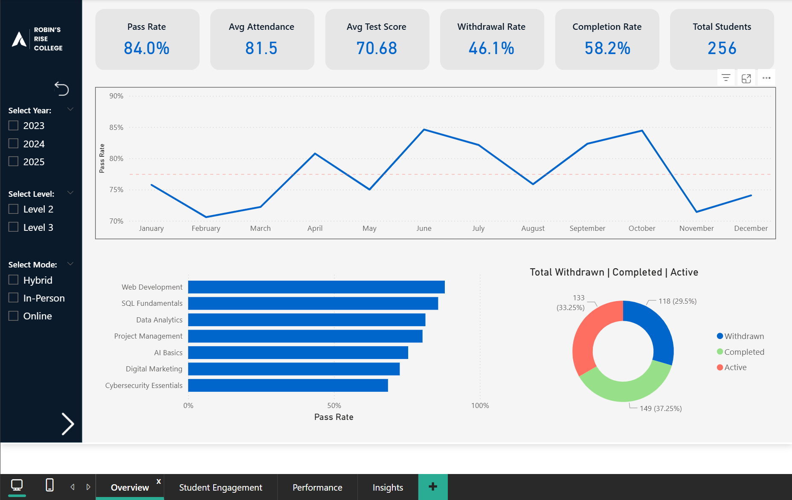
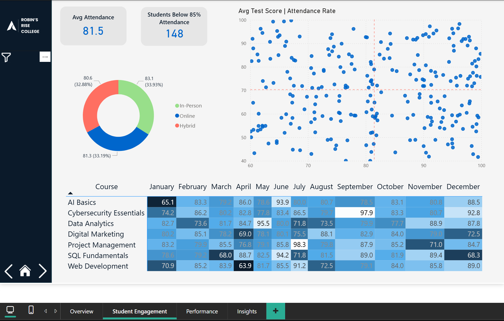
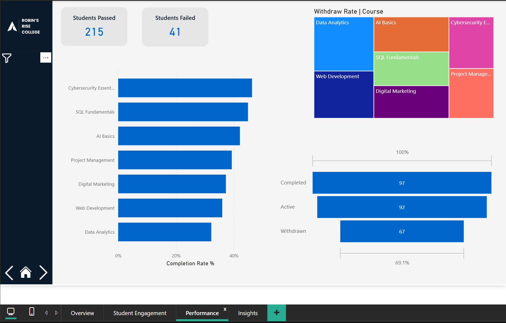
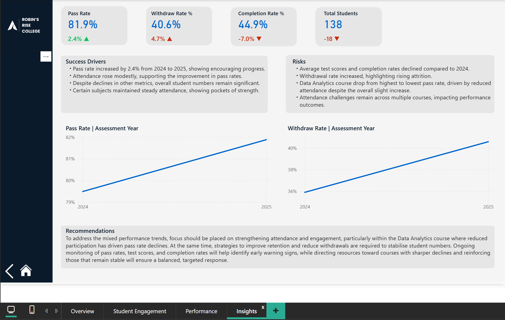

<h2>🎓 College Performance & Student Success Dashboard</h2>

<h3>Power BI | Data Analytics Portfolio Project</h3>

<h3>📌 Project Overview</h3>

This project presents an end-to-end data analytics and Power BI reporting solution analysing student success at a fictional institution, <strong>Robin’s Rise College</strong>, using synthetic data provided by Cenit College.

The dashboard is designed to support academic leadership and operational decision-making by providing visibility into student performance, attendance, withdrawals, and completions. The analysis follows a structured data storytelling approach, progressing from a high-level executive overview to diagnostic analysis and actionable, data-backed recommendations.

---

<h3>🎯 Project Objectives</h3>

<ul>
  <li>Provide an executive-level snapshot of student success and academic outcomes</li>
  <li>Identify trends and year-on-year changes in performance and attendance</li>
  <li>Understand key drivers behind withdrawals and completions</li>
  <li>Highlight risk areas alongside stable or high-performing subjects</li>
  <li>Demonstrate practical Power BI skills in data modelling, DAX, and business-focused reporting</li>
</ul>

---

<h3>❓ Business Questions Answered</h3>

<ul>
  <li>How is the college performing overall in terms of pass rates and completion?</li>
  <li>Are student outcomes improving or declining year-on-year?</li>
  <li>What relationship exists between attendance and academic success?</li>
  <li>Which courses or departments are driving success, and which present risk?</li>
  <li>Where should leadership focus intervention efforts to improve retention?</li>
  <li>How can data be used to identify early warning signs of student withdrawal?</li>
</ul>

---

<h3>🗂️ Data Model</h3>

The original dataset contained a <strong>many-to-many relationship</strong> between students and courses. A <strong>bridging table</strong> was introduced to convert this into two one-to-many relationships, reducing ambiguity and ensuring accurate filtering and aggregation across the model.

---

<h3>📊 Dashboard Structure & Narrative Flow</h3>

<h4>Page 1 — Overview</h4>

<strong>Purpose:</strong> 
Provide a high-level snapshot of overall student success and institutional performance.

<strong>Key features:</strong>

<ul>
  <li>KPI cards: Pass Rate, Average Attendance, Average Test Score, Withdrawal Rate, Completion Rate, Total Students</li>
  <li>Monthly pass rate trend line as the primary narrative anchor</li>
  <li>Pass rate by department bar chart</li>
  <li>Student status distribution (Withdrawn vs Completed vs Active)</li>
  <li>Dynamic year slicer</li>
</ul>

<em>Overview page with dynamic slicer panel</em>

---

<h4>Page 2 — Student Engagement & Attendance</h4>

<strong>Purpose:</strong> 
Explain why performance outcomes look the way they do by analysing student engagement patterns.

<strong>Analysis includes:</strong>

<ul>
  <li>Overall attendance rate and trends across the academic year</li>
  <li>Identification of low-attendance students (&lt;85%)</li>
  <li>Relationship between attendance and academic performance</li>
  <li>Department-level attendance comparisons</li>
</ul>

---

<h4>Page 3 — Performance, Achievement & Withdrawals</h4>

<strong>Purpose:</strong> 
Drill deeper into academic outcomes and identify key withdrawal drivers.

<strong>Analysis includes:</strong>

<ul>
  <li>Pass rates and average test scores by department</li>
  <li>Comparison of high vs low performers</li>
  <li>Withdrawal and completion rates by course</li>
  <li>Funnel-style view of the student journey: Enrolled → Active → Completed / Withdrawn</li>
</ul>

---

<h4>Page 4 — Insights & Recommendations</h4>

<strong>Purpose:</strong> 
Translate analytical findings into clear, actionable insights for decision-makers.

<strong>Includes:</strong>

<ul>
  <li>KPI trend summary</li>
  <li>Key success drivers</li>
  <li>Identified risks and areas of concern</li>
  <li>Data-backed recommendations</li>
  <li>Comparison of early vs late academic year trends</li>
</ul>

---

<h3>🔍 Key Insights Discovered</h3>

<strong>Success drivers:</strong>

<ul>
  <li>Pass rates increased by <strong>2.4%</strong> from 2024 to 2025, indicating improving academic outcomes</li>
  <li>Attendance rose modestly year-on-year, reinforcing its role as a key performance driver</li>
  <li>Overall student numbers remained stable despite mixed performance trends</li>
  <li>Certain subjects maintained steady attendance, highlighting pockets of strength</li>
</ul>

<strong>Risks & areas of concern:</strong>

<ul>
  <li>Average test scores declined compared to 2024, suggesting potential knowledge retention or assessment readiness gaps</li>
  <li>Completion rates fell while withdrawal rates increased, indicating rising attrition risk</li>
  <li>The Data Analytics course declined from the highest to the lowest pass rate, driven by reduced attendance</li>
  <li>Attendance challenges persist across multiple courses, negatively impacting outcomes</li>
</ul>

---

<h3>📌 Recommendations</h3>

To address the mixed performance trends, priority should be given to strengthening attendance and student engagement, particularly within the Data Analytics course, where reduced participation directly contributed to declining pass rates.

Targeted retention strategies are required to reduce withdrawals and stabilise student numbers. This includes early-intervention support for low-attendance students, improved engagement monitoring, and course-level reviews where declines are most pronounced.

Ongoing monitoring of pass rates, attendance, test scores, and completion metrics will help identify early warning signs. Directing resources toward courses with sharper declines while reinforcing practices used by stable, high-performing subjects will support a balanced and data-driven improvement strategy.

---

<h3>🛠 Tools & Skills Demonstrated</h3>

<ul>
  <li><strong>Power BI:</strong> interactive dashboards, slicers, and visual storytelling</li>
  <li><strong>Data Modelling:</strong> star schema design and bridge tables</li>
  <li><strong>DAX:</strong> KPIs, rates, percentages, and trend calculations</li>
  <li><strong>Data Analysis:</strong> year-on-year comparison, performance benchmarking, retention analysis</li>
  <li><strong>Data Storytelling:</strong> executive-focused narrative and insight-driven reporting</li>
  <li><strong>Visual Design:</strong> consistent layout, hierarchy, and readability</li>
</ul>

<em>Project created by Jagadhesh Kumar V as part of a data analytics portfolio to demonstrate business-focused reporting and decision-support using Power BI.</em>

